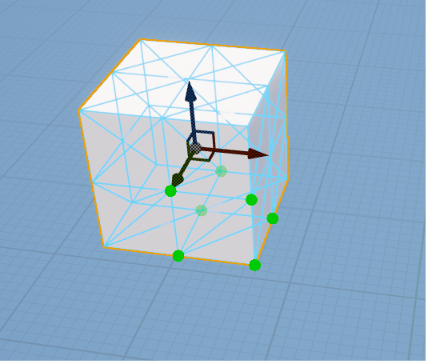
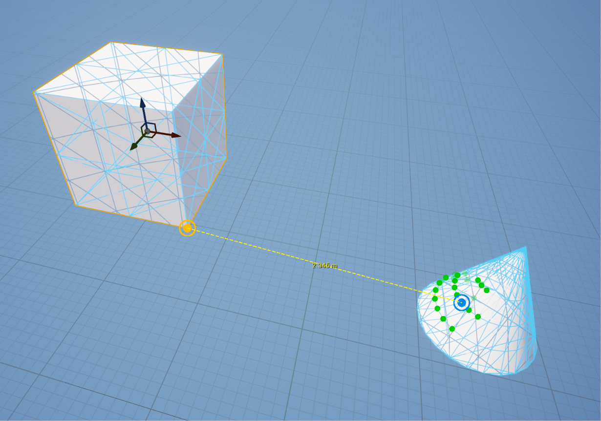
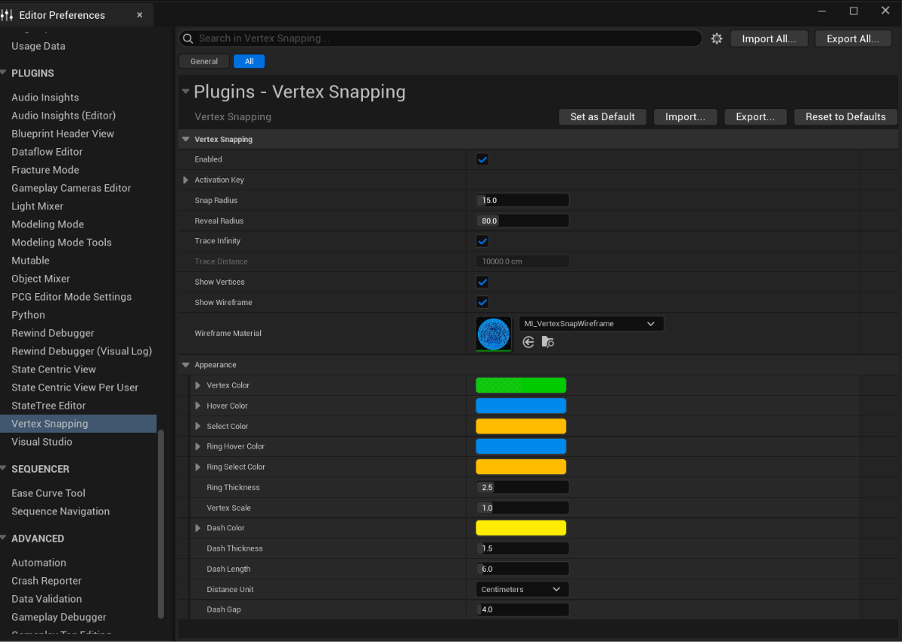
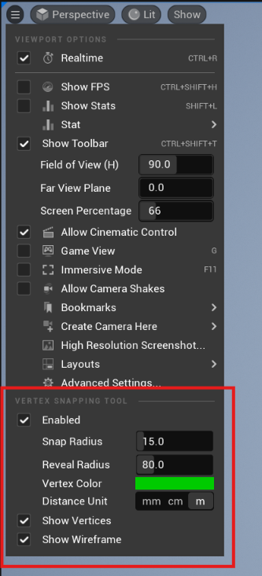
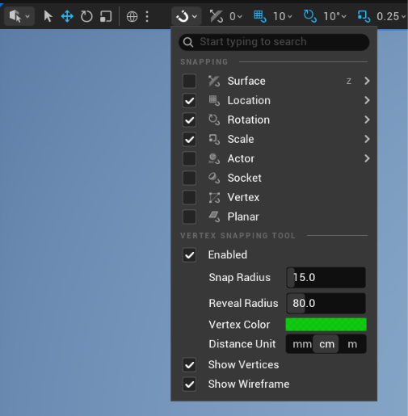

# Vertex Snapping for Unreal Engine 5

Official documentation for the **Vertex Snapping** editor plugin: installation, usage, settings.

**Vertex Snapping** replaces Unreal Engine's built-in "hold V" vertex snapping with a precise **click-click** workflow: pick a vertex on the object you want to move, pick a vertex on the object you want to snap to, done.

- **Engine versions:** UE 5.1 – 5.8
- **Platform:** Windows (Win64), editor only

---

## IMPORTANT

On huge levels, or on meshes with a huge number of vertices (up to millions on a single mesh or level), the editor may hang or crash. Please reconsidering before trying to use the tool.

---

## Contents

1. [Features](#features)
2. [Installation](#installation)
3. [Quick start](#quick-start)
4. [Settings](#settings)
5. [Console commands](#console-commands)
6. [Viewport toolbar](#viewport-toolbar)
7. [Tips](#tips)
8. [Limitations](#limitations)

---

## Features

- **Click-click snapping** — pick a source vertex, then a target vertex. The selection moves by exactly the offset between them.
- **Wireframe overlay** on candidate meshes so you can see their edges through other geometry.
- **ISM / HISM / foliage** — snap whole instanced actors or individual instances.
- **Blueprint editor** — snap components inside a Blueprint's Viewport tab; results are saved into the Blueprint.

---

## Installation

1. Open the **Epic Games Launcher → Library → Fab Library**.
2. Find **Vertex Snapping** and click **Install to Engine**, then choose your engine version.
3. Open your project, go to **Edit → Plugins**, search for **Vertex Snapping**, tick **Enabled**, and restart the editor.

---

## Quick start

1. In the level viewport, **select** the actor you want to move.
2. **Hold V** with the mouse over the viewport.
3. Mouse move and hover the selected actor — the nearest vertex to the mouse will lights up. **Click** it. This is the **source**.

   

4. Hover the object you want to snap to — its nearest vertex lights up and a dashed line shows the distance. **Click** on the target vertex to snap to it.
5. The selected actor moves so the source vertex sits exactly on the target vertex.

   

Rules worth knowing:

- **The source** must be on a **selected** object.
- **The target** can be on any visible static mesh. It can also be on the moving object itself — the object then shifts by that offset (useful for "move this by exactly one tile").
- **The target never moves.** Only the selection does.
- **Camera controls keep working** (RMB, MMB, wheel, WASD) while V is held, so you can reframe between clicks. The locked source stays in place.
- Clicks while V is held never change your selection.
- If no vertex is within the **Snap Radius**, the click does nothing.
- If nothing is selected, the tool does nothing.

---

## Settings

You can adjust the tool's behavior and appearance to suit your work environment in **Edit → Editor Preferences → Plugins → Vertex Snapping**. Settings are saved per user and per project.

### General

| Setting | Default | Description |
|---|---|---|
| Enabled | On | Off disables the tool; V uses the engine's built-in vertex snapping. |
| Activation Key | V | Key held to use the tool. Modifiers must match exactly (so Alt+V and Shift+V keep their engine functions). |
| Snap Radius | 15 px | Cursor distance within which the nearest vertex can be picked (2–100). |
| Reveal Radius | 80 px | Cursor distance within which vertex dots are shown (2–300). |
| Trace Infinity | On | Consider vertices at any distance from the camera. |
| Trace Distance | 10000 cm | When Trace Infinity is off, ignore vertices farther than this (e.g. sky spheres). Perspective viewports only. |
| Show Vertices | On | Draw the revealed vertex dots. The hovered and picked vertices are always drawn. |
| Show Wireframe | On | Draw the wireframe overlay on pickable meshes. |
| Wireframe Material | `MI_VertexSnapWireframe` | Overlay material. Use a translucent material with **Wireframe** and **Disable Depth Test** enabled. |

### Appearance

| Setting | Default | Description |
|---|---|---|
| Vertex Color | Green | Revealed vertex dots |
| Hover Color | Blue | Dot under the cursor |
| Select Color | Orange | Picked source dot |
| Ring Hover Color | Blue | Ring around the hovered dot |
| Ring Select Color | Orange | Ring around the source dot |
| Ring Thickness | 2.5 px | Ring line thickness before Vertex Scale (0.5–10) |
| Vertex Scale | 1.0 | Scales all dots and rings (0.25–4) |
| Dash Color | Yellow | Dashed line and distance label |
| Dash Thickness | 1.5 px | Dashed line thickness (0.5–10) |
| Dash Length | 6 px | Length of each dash (1–50) |
| Dash Gap | 4 px | Gap between dashes (0–50); 0 = solid line |
| Distance Unit | Centimeters | Millimeters / Centimeters / Meters |

---

## Console commands

Run without an argument to toggle, or pass `0` / `1`. Values are saved like the settings page.

| Command | Effect |
|---|---|
| `VertexSnapping.Enabled [0\|1]` | Enable/disable the tool |
| `VertexSnapping.ShowVertices [0\|1]` | Show/hide revealed vertex dots |
| `VertexSnapping.ShowWireframe [0\|1]` | Show/hide the wireframe overlay |

---

## Viewport toolbar

Quick controls live in the level viewport toolbar in every supported engine version (5.1 – 5.8). Where to find them depends on which viewport toolbar your engine uses:

- **UE 5.1 – 5.5 (classic toolbar):** viewport **Options** (▼) dropdown → **Vertex Snapping Tool** section.
- **UE 5.6+ (new toolbar):** viewport toolbar **Snapping** menu (magnet icon) → **Vertex Snapping Tool** section.
- **UE 5.6 with the classic toolbar enabled:** the **Options** (▼) dropdown, same as 5.1 – 5.5.

The toolbar, settings page and console commands always stay in sync.

**Classic toolbar (5.1 – 5.5):**

**New toolbar (5.6+):**

---

## Tips

- **Large levels feel noisy?** Lower **Reveal Radius**, or turn off **Show Vertices** and rely on the hover highlight.
- **Hard to hit a vertex on small meshes?** Zoom in between the clicks — the source stays locked.
- **Big background meshes stealing the target?** Turn off **Trace Infinity** and set a **Trace Distance**.
- **Need the old behavior for a moment?** Toggle **Enabled** in the toolbar, or run `VertexSnapping.Enabled 0`.
- **Snap a row of pieces:** keep V held and snap piece after piece; each snap is its own undo step.
- **Move by an exact mesh dimension:** pick source and target on the same selected mesh (e.g. two opposite corners).

---

## Limitations

- Snaps **translation only** — rotation and scale are not changed.
- **Static meshes** only (including ISM/HISM/foliage). Skeletal meshes, BSP brushes and landscape are not supported.
- Snap points are **mesh vertices** only (no edge midpoints or face centers).
- The viewport toolbar section is in the **level** viewport only; the Blueprint viewport uses the same settings.
- In the Blueprint editor, components created by the **Construction Script** and C++ components that are not editable cannot be moved (same as the engine's gizmo). They can still be used as targets.
- Editor only, Windows (Win64).
